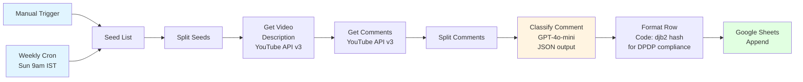

# YouTube Comment Miner

500 to 5,000 pre-purchase consumer comments sit untouched on every popular YouTube review video. PDP reviews on 1mg and Amazon are post-purchase, templated, often shaped by the discount code. The YouTube signal is predictive. The PDP signal is diagnostic. Brands pay more for predictive, but no one in Indian Consumer Health is mining it systematically.

This workflow does.

## What it ships

Every Sunday 9am IST, the workflow pulls comments from a seed list of YouTube review videos, classifies each one by intent, and appends a structured row to a Google Sheet. Brand teams open one sheet on Monday morning and see what consumers actually asked, objected to, compared against, and trusted.

Three outputs, same pipeline:
1. **Google Sheet** — one row per comment, 10 columns, filterable by objection, use case, competitor mention, trust signal, claim reaction, or noise.
2. **Looker Studio dashboard** (reader surface) — top objections, competitor mindshare, theme trends, top comments by likes.
3. **Monthly PDF report** — 8 pages written by Claude Sonnet 4.5 from the sheet data. Executive summary, verbatim quotes, recommended actions. Reads like a brief, not a data dump.

## v1 scope (shipped)

- Vertical: Consumer Health, India
- Demo brand: Ensure Protein (Abbott Nutrition)
- 3 seed videos: 1 English review, 1 Hindi review, 1 Ensure vs Horlicks Short
- 157 classified rows in 1 production run
- 92 to 95% classification accuracy on spot-check (English + Hindi + Hinglish + Gujarati scripts)
- Running cost: ~Rs 145/month at current volume
- Weekly auto-run via Cron, with manual trigger for on-demand runs

## What this unlocked for Ensure Protein (sample findings)

- "Abbot is not manufacturing this product" — trust crisis signal, repeated by multiple commenters
- "I had taken ensure for six months but of little use" — effectiveness objection, churn risk
- "Mujhe dr ne diya tha" — doctor recommendation as trust signal
- Diabetes safety questions in top 10 themes every run
- Post-childbirth recovery and tuberculosis patient nutrition as unlisted but repeat use cases
- Competitive mindshare shifting from legacy brands (Horlicks, Complan, Protinex) to D2C whey challengers (Beast Life, Avvatar, Nutrija, Quenchlabz)

Not one of these came from a research agency brief. They came from reading what Ensure's own consumers typed, free, in public, before purchase.

## Architecture

## Stack

- **Orchestration**: n8n (self-hosted, technoelogy.n8ns.host)
- **Comment source**: YouTube Data API v3 (public, authenticated via API key)
- **Classification**: OpenAI GPT-4o-mini, temperature 0.1, JSON mode
- **Storage**: Google Sheets
- **Hashing**: pure JS djb2 (n8n sandbox blocks require('crypto'))
- **Reserved for v2**: Supabase pgvector + OpenAI embeddings + Cohere Rerank for chat-queryable comment corpus

## Compliance posture

- **YouTube API ToS §III.E**: comment text + derived insights stored. Author identity hashed. Original comment author names stripped from client deliverables. 30-day refresh cycle planned for v1.1 to purge comments deleted upstream.
- **India DPDP Act 2023**: author channel ID is hashed (SHA-equivalent 8-char djb2) on write. No raw identifiers leave the workflow. Legal review recommended before first paid client pitch.

## Setup

1. Clone repo, import `youtube-comment-miner-v1.json` into n8n
2. Create YouTube Data API v3 key on GCP, restrict to YouTube API only
3. Wire 4 credentials in n8n: YouTube (Query Auth, `key=YOUR_KEY`), OpenAI (existing API key), Google Sheets (OAuth), Google Drive (if using file export)
4. Create a Google Sheet with headers: `Date | Brand | Video ID | Video Title | Comment (verbatim) | Classification | Theme | Competitor Named | Author Hash | Likes`
5. Update Seed List node with your 3 target video IDs
6. Execute workflow manually once to verify, then Publish to activate the weekly schedule

Full build notes in `BUILD-NOTES.md`.

## What's deferred

- Pagination beyond first 100 comments per video (YouTube caps a single commentThreads.list call)
- Video transcription (Apify yt-dlp) + GPT-4o video context layer for "what did the YouTuber actually claim at 2:14"
- Comment corpus as RAG, chat-queryable by brand manager ("show all comments mentioning artificial sweeteners across protein brand review videos, last 90 days")
- Error log tab for silent-drop monitoring
- Classifier prompt tightening to stop tagging "Ensure" as its own competitor

v1 ships because it works, not because it's finished.

## License

MIT. Use it, fork it, ship your own.

## Author

Tron (Noel Gomes) — digital marketer working in Consumer Health, OTC, and pharma in India. Building tools under [technoelogy.com](https://technoelogy.com) as the lab for an AI Automation Studio for brand teams.

LinkedIn: [gomesnoel](https://www.linkedin.com/in/gomesnoel/) · GitHub: [technoelogy](https://github.com/technoelogy)
